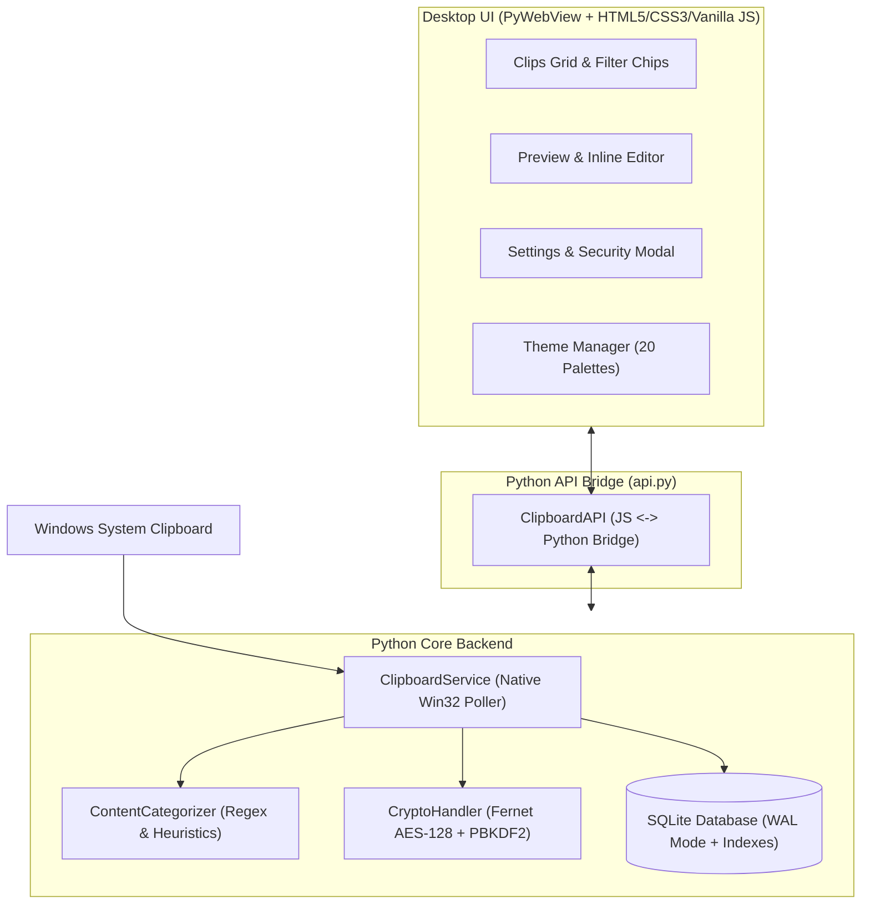

# 📋 ClipBox

[](https://www.python.org/downloads/)
[](https://opensource.org/licenses/MIT)
[](https://microsoft.com/windows)
[](https://pywebview.flowrl.com/)

**ClipBox** is a fast, aesthetic, and privacy-focused clipboard manager for Windows. It quietly monitors your clipboard in the background, automatically classifies your clips (URLs, code, emails, phone numbers, passwords, and plain text), encrypts sensitive credentials with Fernet (AES-128-CBC + HMAC-SHA256), and presents everything in a modern, themeable desktop interface.

---

## ✨ Features

- **🧠 Smart Auto-Categorization**
  - Automatically identifies and organizes your clipboard into:
    - 🔗 **URLs**: Web links, domains, and protocols.
    - 📧 **Emails**: Valid email addresses.
    - 📞 **Phone Numbers**: International (+91, +1, etc.) and domestic phone formats.
    - 🔒 **Passwords & Secrets**: API tokens (GitHub, OpenAI, JWT, Bearer) and passphrases.
    - 💻 **Code Snippets**: Python, JavaScript/TypeScript, SQL, JSON, HTML/XML, C++, Go, and Rust.
    - 📝 **Plain Text**: General notes and text.
  - Granular control: selectively toggle which categories are saved automatically in Settings.

- **🎨 20 Aesthetic Themes (Light & Dark)**
  - 10 Light themes: *Sunrise, Mint Fresh, Peach Blossom, Cotton Candy, Sky Breeze, Lemonade, Vanilla Cream, Pastel Rainbow, Ocean Foam, Lily Garden*.
  - 10 Dark themes: *Midnight Blue, Crimson Night, Charcoal, Emerald Dark, Amethyst, Slate, Burnt Orange, Cosmic Black, Deep Ocean, Mystic Berry*.
  - Instant toggle with header switch or hotkey (`Ctrl + T`).

- **🔒 Military-Grade Password Encryption**
  - Secure sensitive clips with a master passkey.
  - Employs Fernet (PBKDF2-HMAC-SHA256 with 100,000 iterations + AES-128-CBC + HMAC-SHA256).
  - Sensitive clips are masked with blur and can be viewed or copied only after entering your passkey.
  - One-click "Lock Passwords Now" button to immediately purge the decryption cipher from memory.

- **⚡ Zero-Latency & High-Performance Architecture**
  - **SQLite WAL Mode**: Non-blocking concurrent reads and writes, eliminating database lock contention.
  - **Smart Version Polling**: Replaced expensive DOM re-renders with microsecond version checks (`< 0.1ms`). New clips appear smoothly within 800ms with zero CPU overhead when idle.
  - **Recopy Auto-Bump**: Re-copying an earlier clip automatically refreshes its timestamp and bumps it back to the top of your recent list.

- **🔍 Real-Time Instant Search & Filtering**
  - Search any text snippet across thousands of clips with instant debounced matching.
  - Filter chips for **📌 Pinned** and **⭐ Favorites** to access your most important snippets immediately.

- **✏️ In-App Preview & Text Editor**
  - Inspect any clip in a dedicated preview modal showing category, timestamp, character count, and formatted text.
  - Built-in inline editor allowing you to modify and save clip contents directly.

- **➕ Floating Quick-Add Bar**
  - Type or paste snippets manually at the bottom of the screen with quick category selection.
  - Submit with `Enter` or `Ctrl + Enter`.

- **📤 Data Export & Automatic Cleanup**
  - **Export**: Save your complete clipboard history to a JSON file on your Desktop or Documents folder.
  - **Cleanup**: Delete unpinned clips older than 30 days in one click.

- **🛡️ Clean Non-Admin Windows Integration**
  - Safe, user-level Windows auto-start via standard `HKCU\Software\Microsoft\Windows\CurrentVersion\Run`.
  - **Zero administrator / UAC prompts** needed.

---

## ⌨️ Keyboard Shortcuts

| Shortcut | Action |
| :--- | :--- |
| `Ctrl + F` or `/` | Focus search bar |
| `Esc` | Close any active modal / clear search |
| `Ctrl + N` | Focus quick snippet input |
| `Ctrl + T` | Toggle between Light and Dark mode |
| `Ctrl + I` | Open Statistics modal |
| `Ctrl + ,` | Open Settings modal |
| `Enter` (in input) | Add manual snippet |
| `Ctrl + Enter` (in editor) | Save edited clip |

---

## 🛠️ Architecture & Tech Stack



- **Frontend**: Lightweight HTML5, CSS3 Custom Properties (variables), and modern Vanilla JavaScript.
- **Desktop Shell**: [PyWebView](https://pywebview.flowrl.com/) leveraging the native Microsoft Edge WebView2 runtime.
- **Clipboard Engine**: Native Windows `pywin32` (`win32clipboard`) for sub-millisecond, low-overhead clipboard capture.
- **Storage**: SQLite 3 configured with Write-Ahead Logging (`WAL`), `NORMAL` synchronous mode, and composite indexes.
- **Cryptography**: Python `cryptography` library implementing Fernet symmetric encryption.

---

## 🚀 Getting Started

### Prerequisites

- **Python 3.8+** (Python 3.10, 3.11, or 3.12 recommended)
- **Windows 10 / 11** (with Edge WebView2 runtime, pre-installed on Windows 10/11)

### Installation

1. **Clone the repository:**
   ```bash
   git clone https://github.com/kiranmayee-abbireddy/clipboard-org.git
   cd clipboard-org
   ```

2. **Create a virtual environment (optional but recommended):**
   ```bash
   python -m venv venv
   .\venv\Scripts\activate
   ```

3. **Install dependencies:**
   ```bash
   pip install -r requirements.txt
   ```

4. **Run the application:**
   ```bash
   python src/main.py
   ```

### Command Line Options

```bash
# Run with developer tools / webview console enabled
python src/main.py --debug

# Run headless background monitor only (no GUI window)
python src/main.py --headless

# Or run the standalone monitor directly
python src/clipboard_monitor.py
```

---

## 📦 Building Standalone Executable (.exe)

You can build a single, portable `.exe` binary using PyInstaller:

```bash
pyinstaller ClipBox.spec
```

The resulting standalone executable will be generated at:
```
dist/ClipBox.exe
```

The optimized `.spec` file automatically strips unused frameworks and includes all required HTML/CSS/JS frontend assets and the application icon.

---

## 📁 Project Structure

```
clipboard-org/
├── ClipBox.spec               # Optimized PyInstaller packaging specification
├── clipbox.ico                # Application icon
├── requirements.txt           # Python dependencies
├── setup.py                   # Package setup configuration
├── .gitignore                 # Git ignore rules
├── README.md                  # Comprehensive documentation
├── src/
│   ├── main.py                # Desktop application entry point (PyWebView)
│   ├── api.py                 # JavaScript <-> Python API bridge
│   ├── background.py          # Windows user-level autostart management
│   ├── clipboard_monitor.py   # Headless background monitor runner
│   ├── backend/
│   │   ├── categorizer.py     # Content classification & regex heuristics
│   │   ├── clipboard_service.py # Native Windows clipboard reader/writer
│   │   ├── crypto_handler.py  # Fernet encryption & PBKDF2 key derivation
│   │   └── database.py        # SQLite database layer with WAL mode
│   └── frontend/
│       ├── index.html         # Main application interface
│       ├── css/
│       │   ├── styles.css     # Core layouts, modals, and animations
│       │   └── themes.css     # 20 Light and Dark theme palette definitions
│       └── js/
│           ├── app.js         # Frontend controller, search, and polling
│           └── themes.js      # Dynamic theme engine
└── tests/
    ├── test_backend.py        # Unit tests for database, categorizer & crypto
    ├── test_api.py            # Integration tests for ClipboardAPI
    └── test_e2e_simulation.py # End-to-end simulation of frontend-backend flows
```

---

## 🧪 Running Tests

A complete automated test suite is included in `tests/`:

```bash
# Run backend tests (Database, Cryptography, Categorizer)
python tests/test_backend.py

# Run API integration tests
python tests/test_api.py

# Run end-to-end API simulation
python tests/test_e2e_simulation.py
```

---

## 🤝 Contributing

Contributions, bug reports, and feature requests are welcome!

1. Fork the Project
2. Create your Feature Branch (`git checkout -b feature/AmazingFeature`)
3. Commit your Changes (`git commit -m 'Add some AmazingFeature'`)
4. Push to the Branch (`git push origin feature/AmazingFeature`)
5. Open a Pull Request

---

## 📄 License

This project is licensed under the MIT License. See the [LICENSE](LICENSE) file for details.
